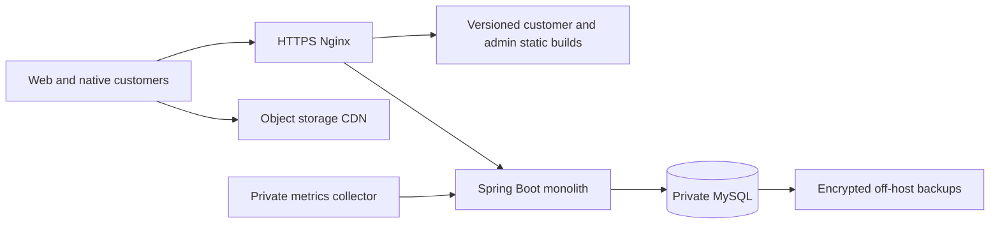

# PROD-001 production architecture

2026-10-25, Asia/Karachi. Preparation only; no services provisioned or public deployment performed. Keep the existing Spring Boot modular monolith and MySQL contracts. Neither measured laptop throughput nor a merged PR establishes commercial capacity.

## Option A: operated initial launch

One 2-vCPU/4-GiB Linux host runs Nginx, the application and a properly operated MySQL instance on a private container network. Publish only HTTPS; SSH uses owner-approved keys/source restrictions. Never publish MySQL, metrics, Docker or an administrative bootstrap endpoint. The existing preparation Compose intentionally binds HTTPS to loopback; a later reviewed deployment must explicitly approve ingress and DNS/TLS.

Starting resource budgets, **not measured capacity**: JVM heap 512–768 MiB inside a 1-GiB application container; MySQL 1–1.5 GiB with a measured buffer pool; OS/proxy/static hosting/collector remaining memory. Bound app pool to 10 connections and 64 servlet threads initially. Check the total pool budget across application replicas, migration jobs and administration against MySQL's limit with reserved headroom. Avoid swapping a database under load. Alert on disk, connections, locks and backup failures.

Serve independently versioned web/admin bundles with their actual API origin. Keep HTML short-lived/no-cache, content-hashed assets immutable, API responses uncached. Product images need an actual upload/reference contract: the current database does **not** implement a secure image-upload pipeline. Plan private upload credentials/presigned uploads, size/type validation, image transformation and public read-only CDN variants. Never use fictional bundled showcase images as evidence of live brand media.

This option has a host/database single point of failure and requires an assigned operator, patching, off-host encrypted backups, restore drills and an approved outage budget. A daily VM snapshot alone is insufficient database recovery. Prefer a small managed database if the owner cannot operate MySQL reliably.

## Option B: growth and improved availability

Two independently deployable application/static-web nodes behind a regional HTTPS load balancer; private managed MySQL primary plus two standby nodes (exact topology/failover support verified before purchase); object storage/CDN; off-host monitoring/log collection and encrypted backup storage. Retain database-backed invitation quotas and current account/grant checks across instances. JWT signing keys must be consistent across replicas and rotated by an approved procedure; do not introduce a cache that delays account revocation. No sticky HTTP session is required by the current bearer API.

Keep one migration operator per release and deploy schema changes compatibly. Scale application replicas only after checking database lock waits, query plans and pool capacity. Shared product/brand/category locking can limit checkout throughput even when application CPU is available. More replicas do not fix hot-row contention. A managed standby is not a backup, and this design does not promise survival of a region-wide outage.

Growth triggers (proposed policy, not a claimed SLA): sustained CPU >70% for 15 minutes with acceptable DB headroom; p95 reads >500 ms or writes >1 s for 10 minutes; connection waiting >0 for two minutes; JVM/container memory >80%; disk >75% or backup window approaching its budget. Determine whether the constraint is application CPU, generator, database I/O, locks or queries before resizing. Retest after every material change.

## Monthly budget, USD, before tax

Official public list prices checked 2026-10-25; region, taxes, transfer and provider changes require a fresh checkout estimate. These are planning arithmetic, not a provider quote or spending authorization. No services were purchased.

| Component | A: self-operated | B: growth assumptions |
| --- | ---: | ---: |
| Basic 2-vCPU/4-GiB VM | 1 × $24 = $24 | 2 × $24 = $48 |
| Regional load balancer | Nginx on host, $0 additional | Starting at $12 |
| MySQL | Operated on host; included compute, substantial operator work | 3 × 4-GiB/2-vCPU Standard nodes at $60.90 = $182.70 |
| DB storage allowance | Host disk; capacity monitored | 3 × 60 GiB × $0.215 = $38.70 allowance; verify calculator inclusion to avoid double billing |
| Object storage/CDN | $5 base | $5 base |
| Daily VM backup estimate | 30% × $24 = $7.20 | 30% × $48 = $14.40 |
| Email, extra backup retention, monitoring, domain allocation/contingency | $10–25 planning allowance, not a quoted service price | $30–75 planning allowance |
| **Estimated total** | **$46.20–61.20/month** | **$330.80–375.80/month** |

An initial managed-DB variation adds one 2-GiB node budgeted at $30.45 and a conservative 30-GiB storage allowance of $6.45 to option A, approximately **$83.10–98.10/month**. Confirm whether quoted node prices include storage and remove any duplicated allowance. A single small managed node still has availability limitations. Staff time, paid Apple enrollment, payment/courier fees, premium support, taxes and substantial traffic/storage overages are excluded. The $5 object-storage base currently lists 250 GiB storage and 1 TiB outbound; audit actual media sizes and traffic instead of treating it as unlimited.

Sources: [VM plans](https://www.digitalocean.com/pricing/droplets), [managed MySQL node/storage pricing](https://www.digitalocean.com/pricing/managed-databases), [object storage/CDN](https://www.digitalocean.com/pricing/spaces-object-storage), [regional load balancer](https://www.digitalocean.com/pricing/load-balancers), [backup percentages](https://docs.digitalocean.com/products/backups/details/pricing/).

## Observability preparation

The opt-in `production` profile exposes health, bounded-cardinality request histograms, JVM/process and Hikari metrics through a **separate loopback-only management listener**, default 9091. The application listener continues to deny metrics access. `ProductionManagementSecurity` also checks actual local port and loopback peer; forwarded IP headers do not grant monitoring access. Deploy a host-local collector or a collector sharing the application's network namespace; a collector in an unrelated container cannot reach that container's loopback. Never publish 9091. The supplied `prometheus.yml` and alert rules are preparation, not a running monitoring service or delivered notifications.

Check readiness independently from liveness: readiness includes DB availability; liveness must not restart a healthy JVM merely because MySQL is down. Collect Nginx 429/413 and upstream timeouts separately from application HTTP metrics. Scrape MySQL connection/lock/I/O/buffer-pool metrics with a narrowly scoped monitor user, not runtime root credentials. Enable sampled slow-query analysis privately; redact literals and retain only normalized digests in engineering reports.

Assign an on-call recipient before enabling alerts. Supplied rules cover missing scrapes, >1% backend 5xx, p95 >1 s and sustained pool waits. Also configure disk >75/85%, memory >80/90%, certificate expiry <21/7 days, backup age >26 h, restore-drill overdue and a private synthetic checkout that never handles real funds. Tune low-traffic denominators and route-specific thresholds before paging. Structured ECS logs remain private; do not log Authorization, passwords, invitation tokens, request bodies, query strings, addresses or raw database exceptions into shared dashboards. Apply access control and retention to both logs and backups.
